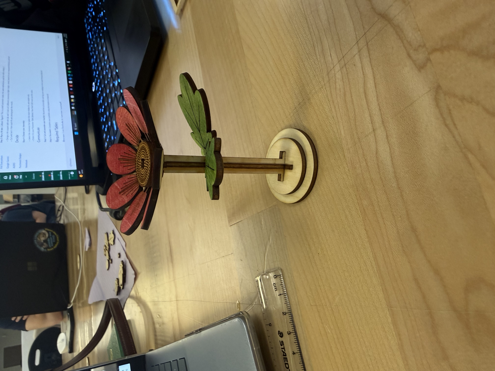
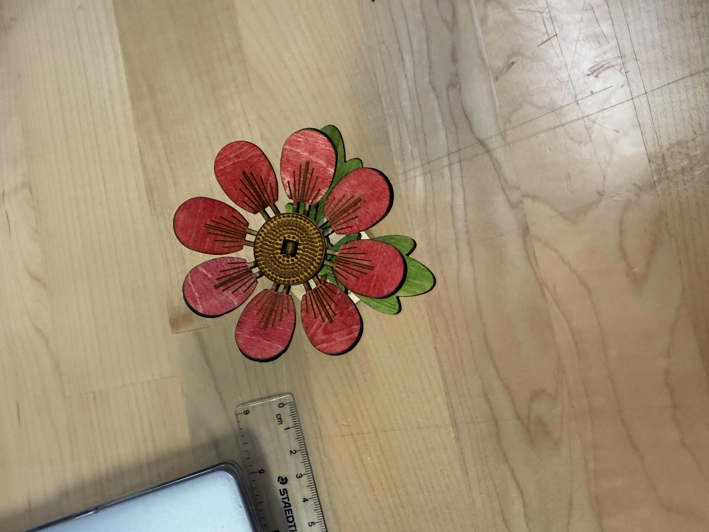
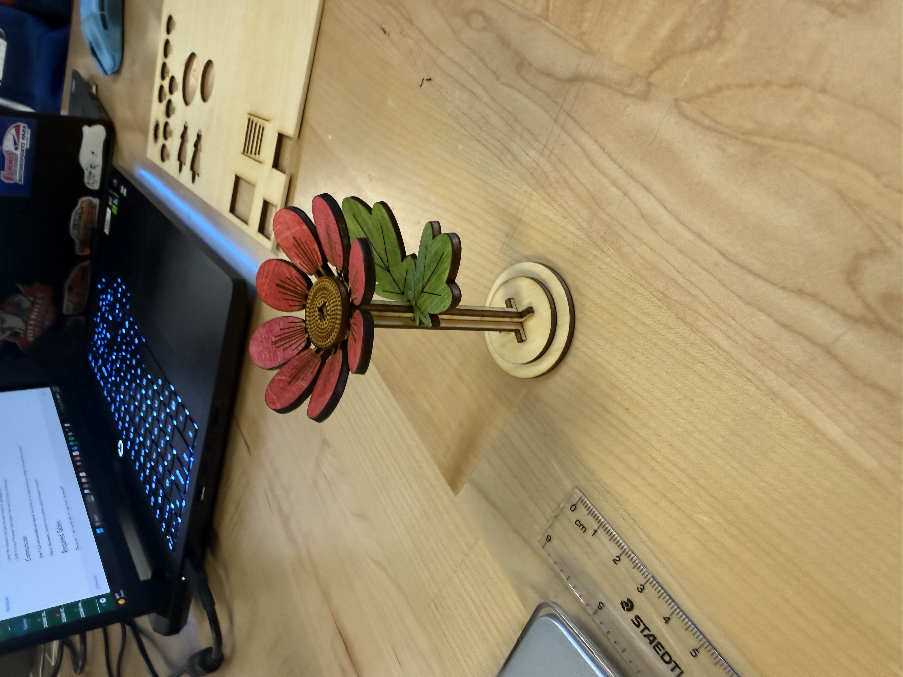
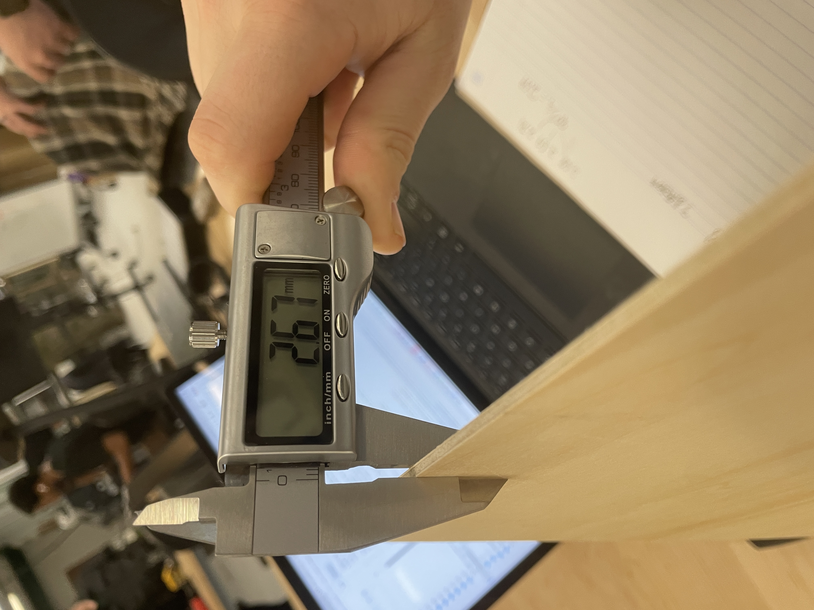
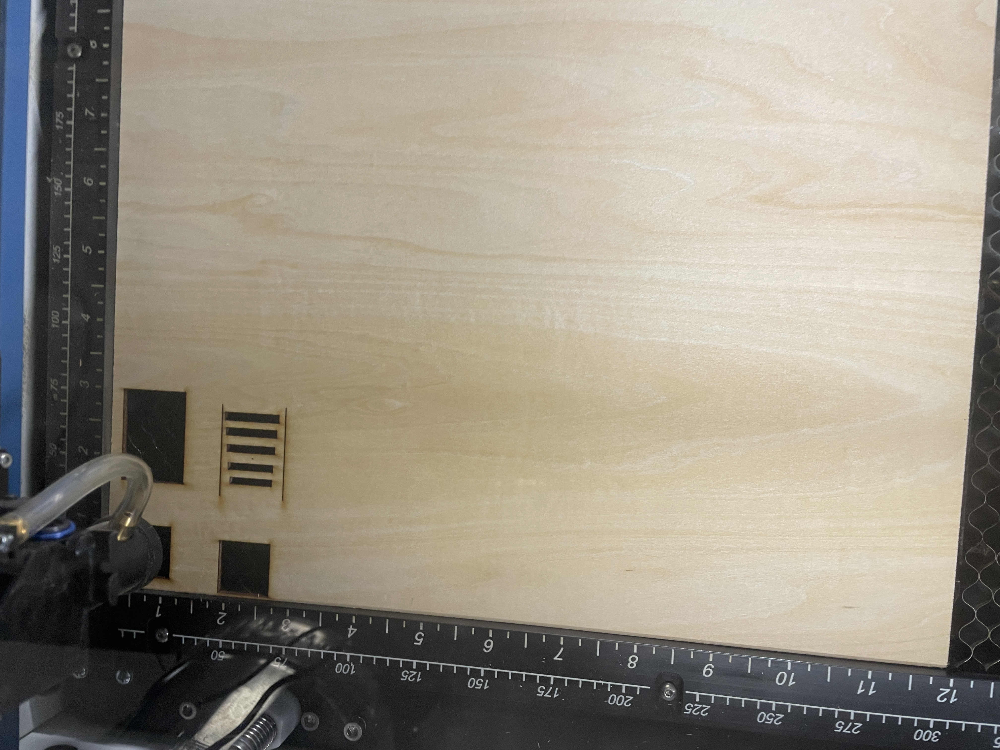
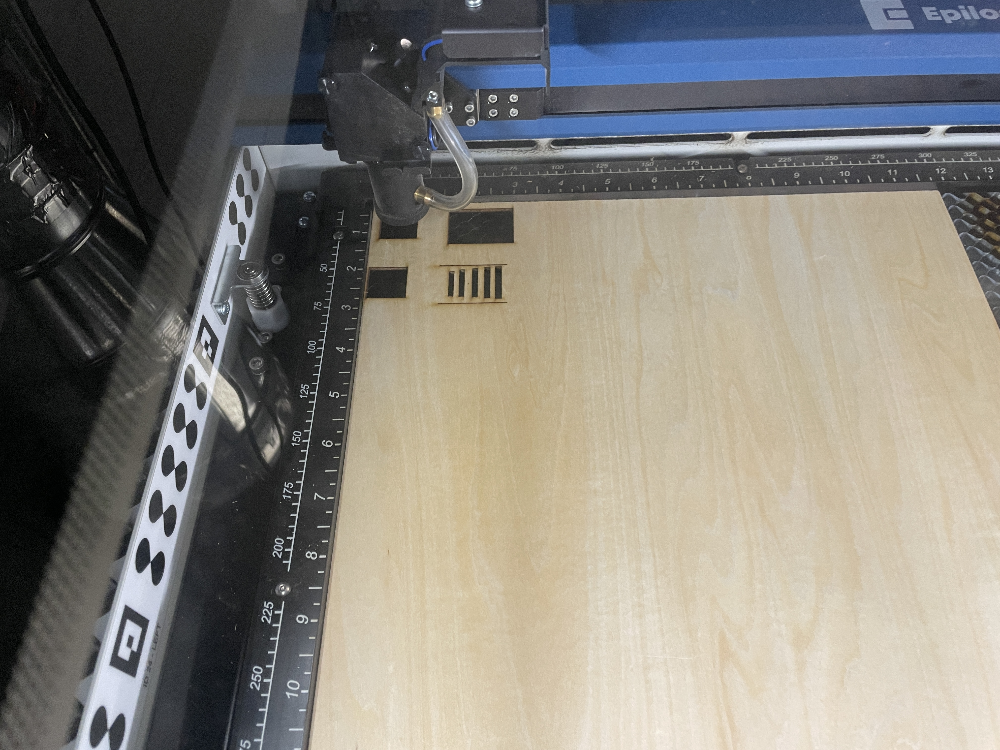
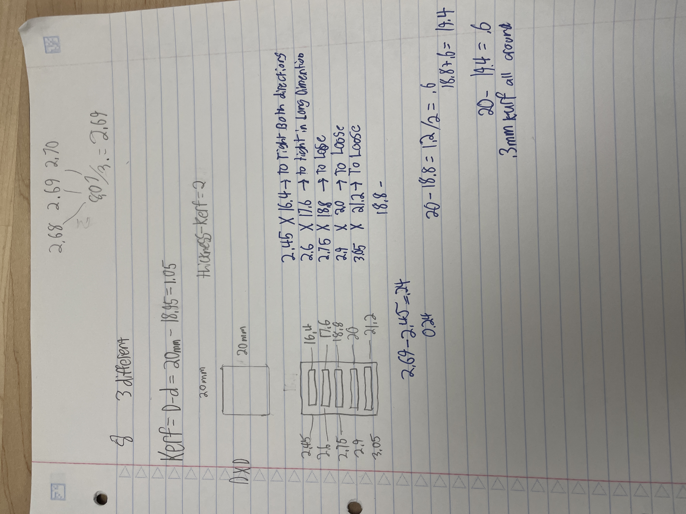

# Lab 9 – Laser Cutter
## Objective
So, for our design project we landed on creating a flower. We chose this because the reality was, we did not want to deal with ultra complex dimensional issues caused by creating an enclosed shape like a box. For a first project I think something like the flower we made was a great solution for not having connections that rely on other connections.
## Team Members
Kaileigh Hill
Austin Williams
Sebastian Kohler
## Design (40%)

.jpeg)
.jpeg)

Explain how your design is parametric (what variables can change? material thickness? slot width? hole spacing?).
Clearly explain how you determined the engineered allowances for the interactive parts:
Material thickness assumption
Kerf measurement method
Final slot/tab dimensions you chose and why
## Manufacturing (30%)

#### Video
https://youtube.com/shorts/Hh_RZBLUwM0?feature=share
Video the laser cutting process (at least one continuous clip).
What laser cutter did you use (machine number/name)?
I used the
| Resource | Description |
|---|---|
| Material | Plywood |
| Sheet Size | 12 × 12 in |
| Average Material Thickness | 2.690 mm |
| Laser Cutter | Epilog CO₂ Laser |
| Measurement Tool | Digital Calipers |
| CAD Software | SolidWorks |
| Assembly Method | Press-fit tabs and slots |
| Additional Fasteners | None |
| Adhesives | None |
What were your laser settings?
Speed 20%
Power 50%
Frequency/PPI (if applicable)
Number of passes
Did you focus the laser? How did you confirm focus?
Did you use air assist / exhaust properly? Any observations?
How did you set your origin and ensure correct alignment?
Show and explain your layout/nesting choices (why parts were arranged that way).
Did you cut test coupons first (kerf test, fit test)? Include pics and results.
Comment on edge quality (burn marks, soot, charring) and what you did to improve it.
## Lessons Learned 
Detailed lessons learned throughout the process (the more detail, the better).
SO, when we started, we did start our assignment very late so when it came down to the wire, I had to set aside my other classes to focus on this project. We of course had some mistakes within preprocessing made our laser cut products curve get messed up. For example, we had a problem where the outside cut before the inside messing up the tolerances. Another example of how we messed up was we deleted to many of our lines by accident and didn't fully cut out one of our shapes.
### Time spent
## Project Fabrication Time Breakdown

| Task | Time Spent |
| :--- | :--- |
| Material Measurement | 15 minutes |
| Kerf and Fit Testing | 30 minutes |
| SolidWorks Design | 1 hour 15 minutes |
| Laser Cutting | 45 minutes |
| Troubleshooting and Recutting | 45 minutes |
| Final Assembly | 30 minutes |
| **Total Time Spent** | **4 hours** |
