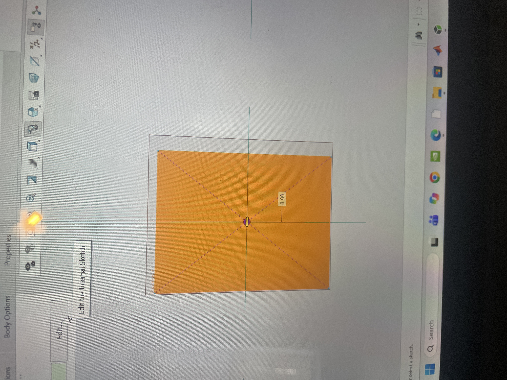
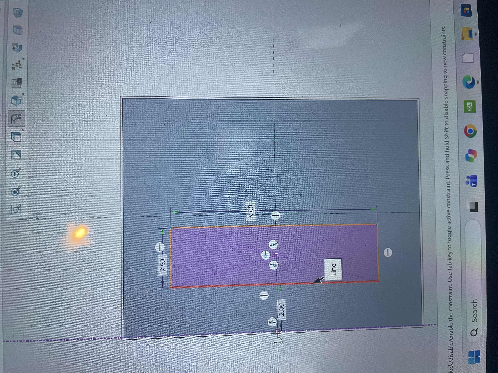
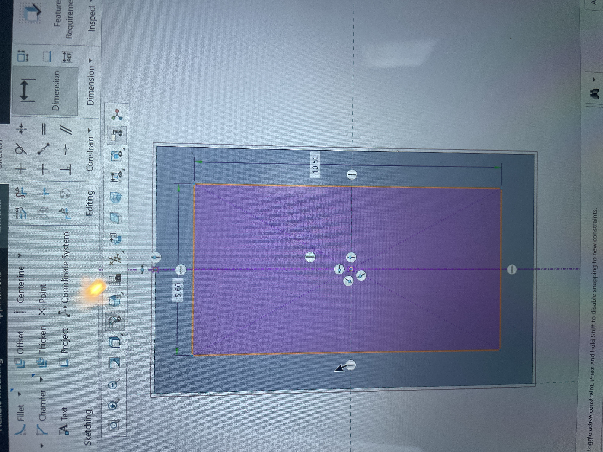
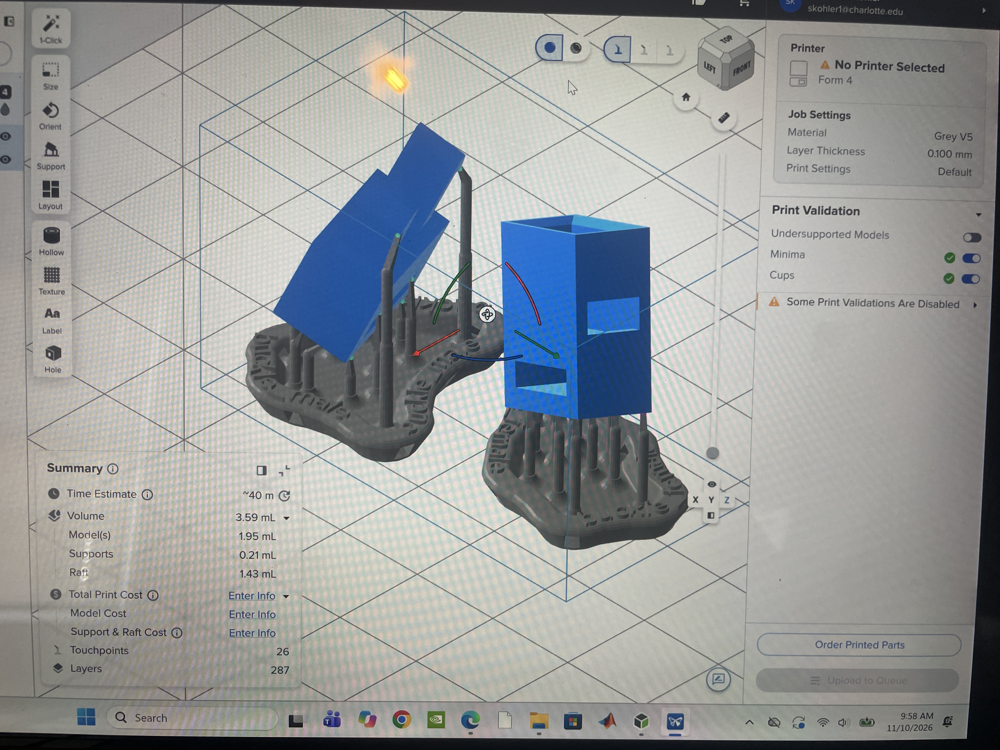

# Lab 11 – Snap Fit Design for SLA Printing (Form 4)
## Snap Fit Research
### Annotated sketches or diagrams

 ### mechanical principles
#### Deflection and permissible strain relationships
The Higher the deflection the more it strains
#### Undercut and mating force relationships
The undercut being to large causes you to have to increase force to put it together while the deflection will go up and it increases the possibility of fracture.
#### How stiffness and geometry affect flexibility and assembly force
The lower the stiffness the lower assembly force and the higher flexibility. The higher the stiffness the lower the flexibility and the higher the assembly Force. The geometry being more favorable for assembly will always reduce the assembly force aswell.
#### SLA resin properties
Sla Is very stiff so you need to make sure you design with fillets and little deflection because you may cause it to break.
## Snap Fit Cad Design

## Preprocessing and 3D Printing

## Post Processing and curing

## Validation

## Lessons Learned
