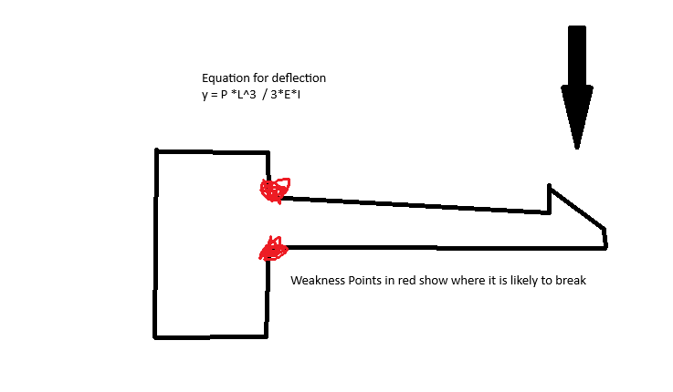
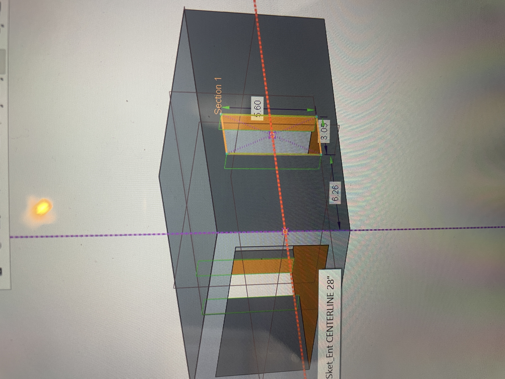
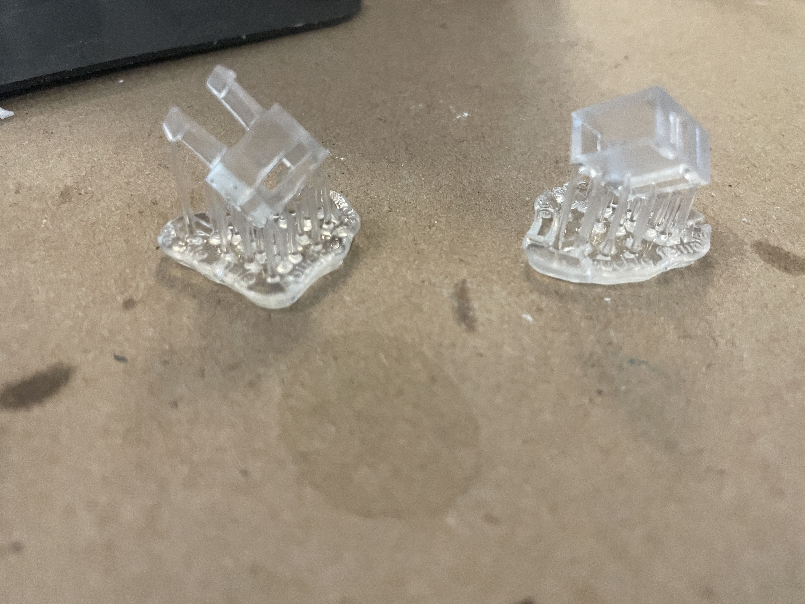

# Lab 11 – Snap Fit Design for SLA Printing (Form 4)
## Snap Fit Research
### Annotated sketches or diagrams

 ### mechanical principles
 Deflection and permissible strain relationships

Undercut and mating force relationships

How stiffness and geometry affect flexibility and assembly force
  SLA resin properties
## Snap Fit Cad Design

## Preprocessing and 3D Printing

## Post Processing and curing
## Validation
## Lessons Learned
