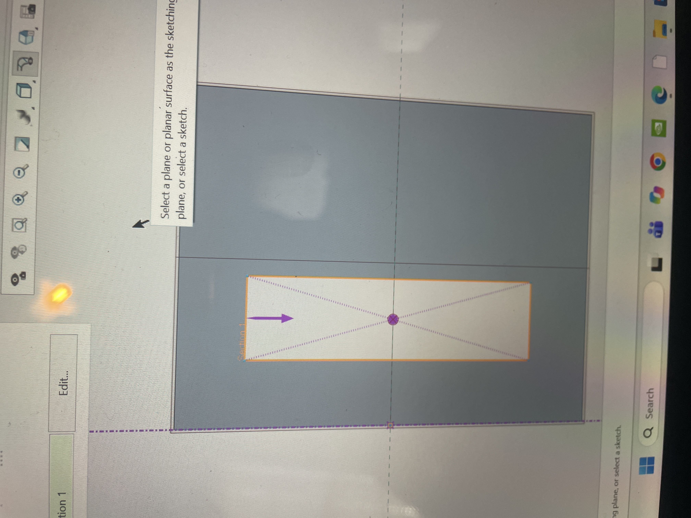
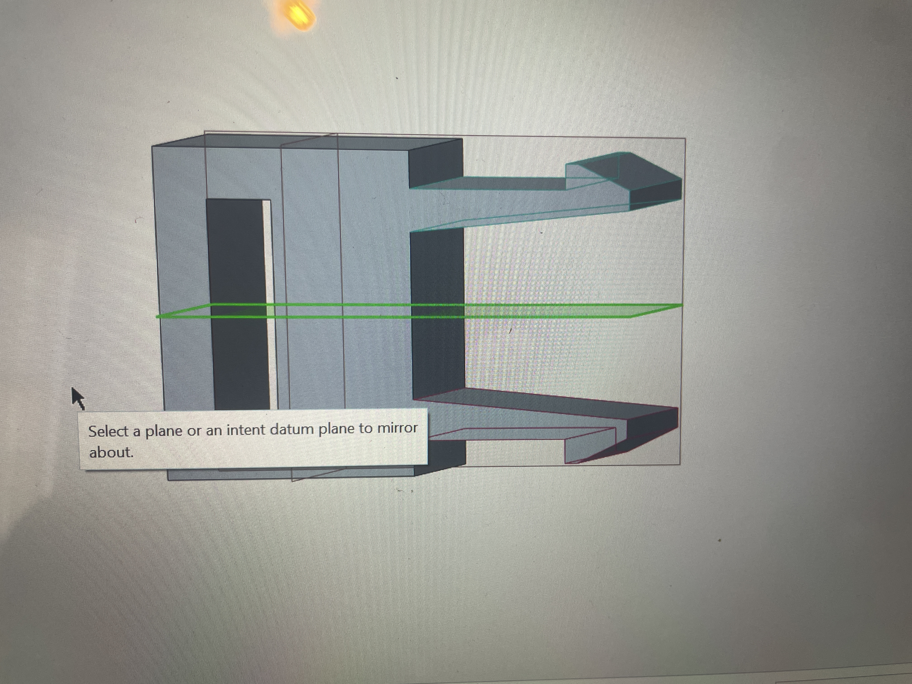
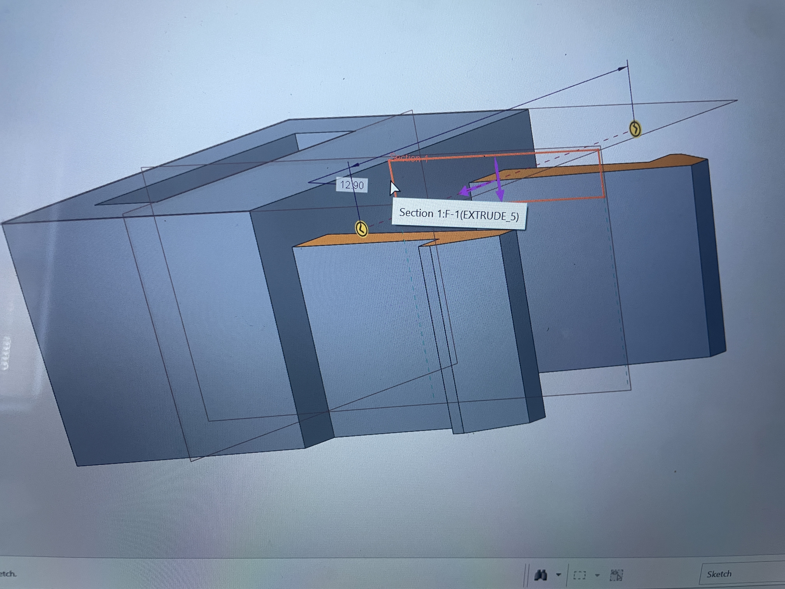
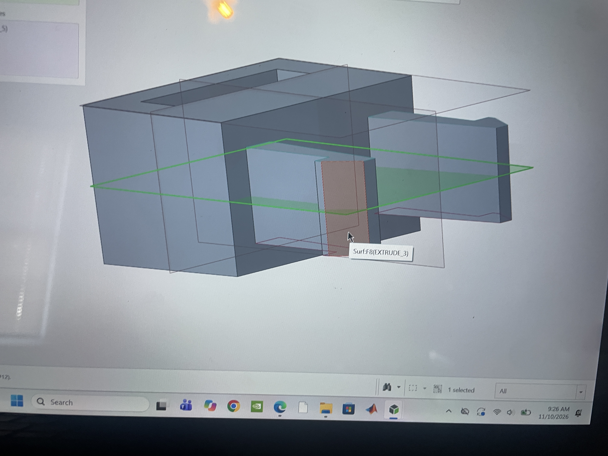
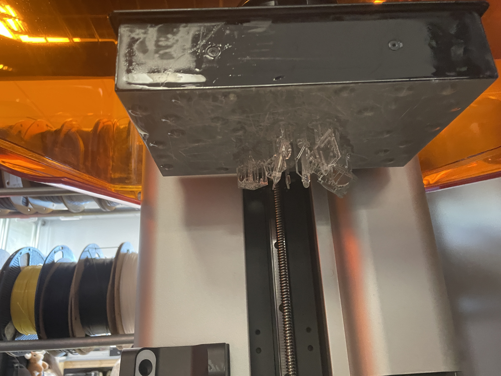

# Lab 11 – Snap Fit Design for SLA Printing (Form 4)
### Assignment: Snap Fit Design for SLA Printing (Form 4)
Summary of the key design principles for your selected snap-fit type (cantilever, annular, torsional, or hybrid).

Annotated sketches or diagrams

 mechanical principles
  SLA resin properties

