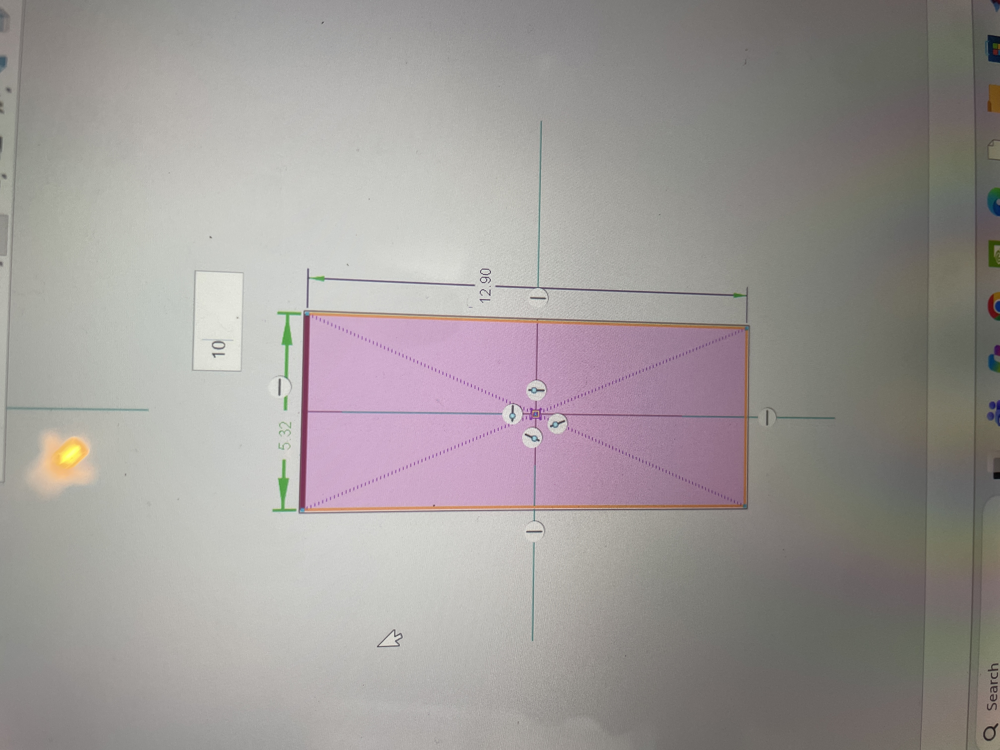
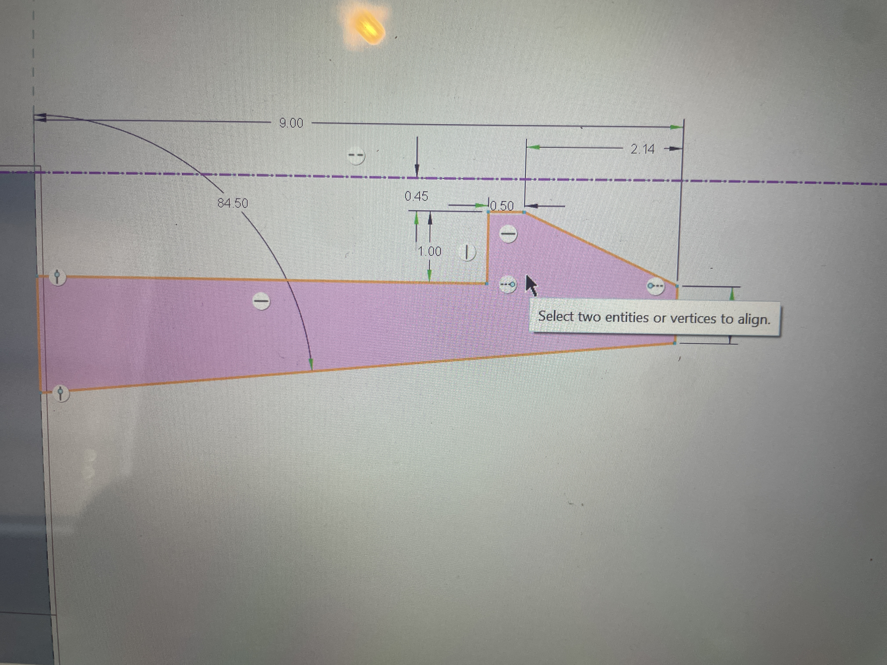
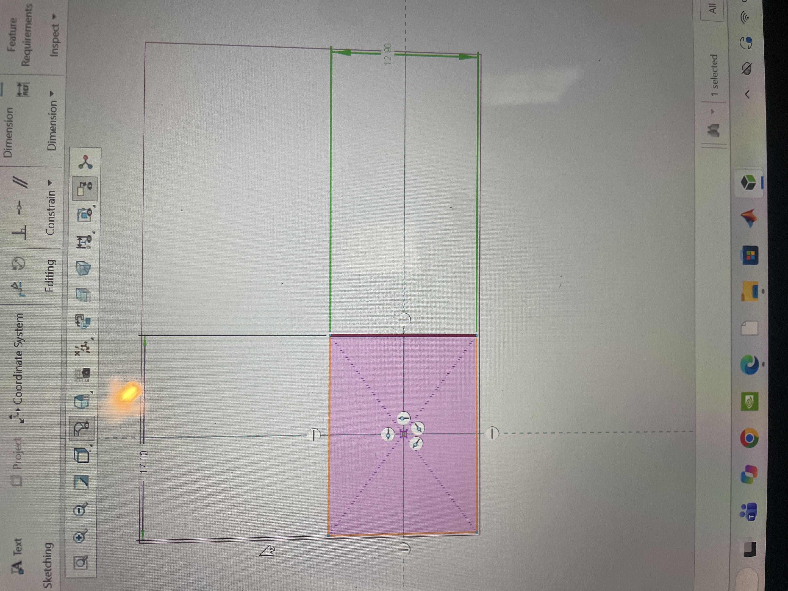
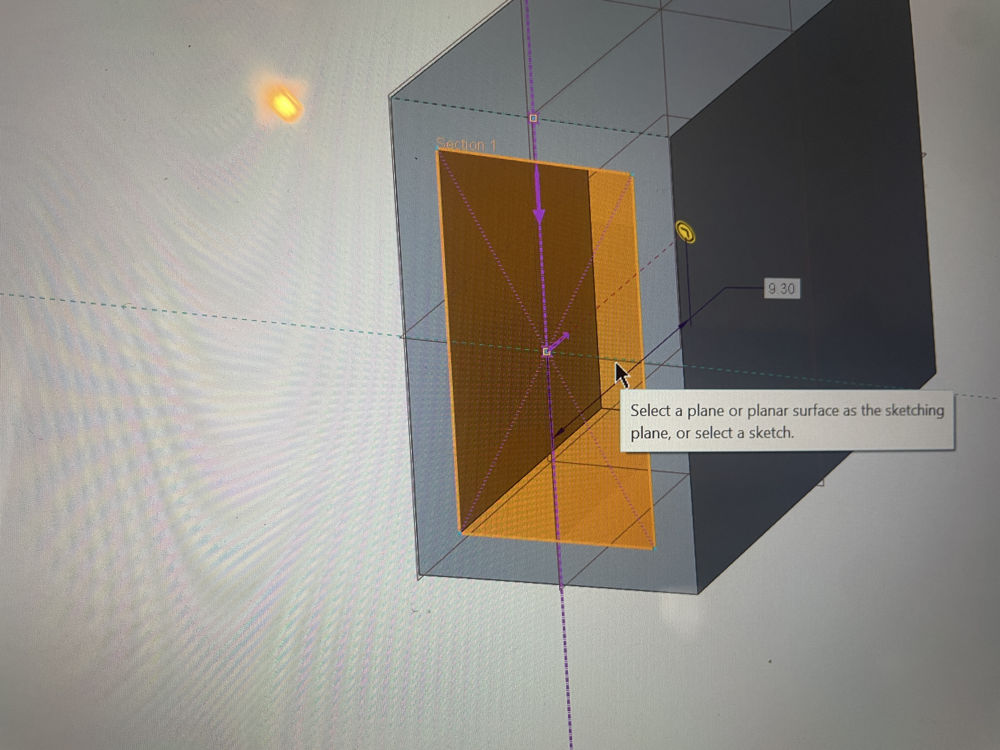
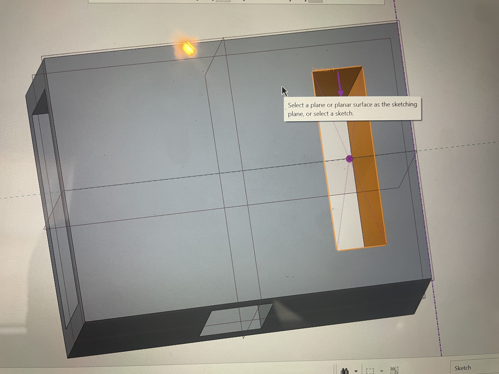

# Lab 11 – Snap Fit Design for SLA Printing (Form 4)
## Snap Fit Research
### Annotated sketches or diagrams

 ### mechanical principles
#### Deflection and permissible strain relationships
The Higher the deflection the more it strains
#### Undercut and mating force relationships
The undercut being to large causes you to have to increase force to put it together while the deflection will go up and it increases the possibility of fracture.
#### How stiffness and geometry affect flexibility and assembly force
The lower the stiffness the lower assembly force and the higher flexibility. The higher the stiffness the lower the flexibility and the higher the assembly Force. The geometry being more favorable for assembly will always reduce the assembly force aswell.
#### SLA resin properties
Sla Is very stiff so you need to make sure you design with fillets and little deflection because you may cause it to break.
## Snap Fit Cad Design
#### type of snap-fit
I made a cantilever snap fit becasue it is the one that i think about a lot in my daily life I interact with buckles all the time. It is funny though before polymers were invented there certainly were a lot less cantilever snapfits.
#### intended function
The Buckle I designed is supposed to hold a strap for a lanyard.
#### iterations or adjustments 
I went though a couple iterations in my head then I drew it in the Creo. 
####

## Preprocessing and 3D Printing

#### Machine name and resin used
We used the clear resin
#### Build orientation and reasoning

#### Layout on the build plate (2–3 student parts per plate)

#### Support strategy, wall thickness, and resolution settings

#### Whether the design is isotropic or anisotropic, and why

#### Clearance used for the snap fit engagement
I did + 5%
#### Slicer settings and screenshot showing print details Layer height, print time, and build volume

## Post Processing and curing
#### Record methods and timing for each step.
The Cleaning took 5 mins the disassembly took 1min and the curing took another 10mins

#### How the curing process affected flexibility or fit
The curing process makes it harder and reduces the flexibility but it also changes the interstitial connections of the part that allow it to be more stiff but also stronger
#### The mechanical differences between SLA and PLA (FDM) parts
I think the main difference it how the layering and lack of fill cause the SLA to be more stiff and higher quality
Surface finish and dimensional precision

## Validation
#### Does the snap engage securely?
Yes
#### Is the fit too tight or too loose?
The fit is Perfect and feels optimal for a lanyard
#### Were adjustments needed to achieve the ideal fit?
THe only adjustgment I would make would be aestetic
#### Include photos or a short video of the assembled artifact.
## Lessons Learned
#### What challenges arose designing for resin flexibility and clearance?
The resin Prints have low flexibility, and I was forced to makes parts that were smaller than I normally am comfortable with because we had a 20ml limit. But the only challenge was that it was something new. However I did work out some of the kinks already last week.
#### What did you learn about SLA tolerances and print orientation?
I learned that the Print orientation would be made so that the spaces we made with tolerances are left open for example a whole in the middle of the part so that we don't have supports put in there.
#### How do SLA snap fits differ from FDM snap fits?
The SLA shrinks in a different way that is different to tolerence than the FDM
#### Comment on cost, time, and resources used from start to finish.
 The Time it took me to complete was about 8 hours. I spent 3 hours deigning 3 hours printing and processing and curing. I then spent 2 hours doing documentation
